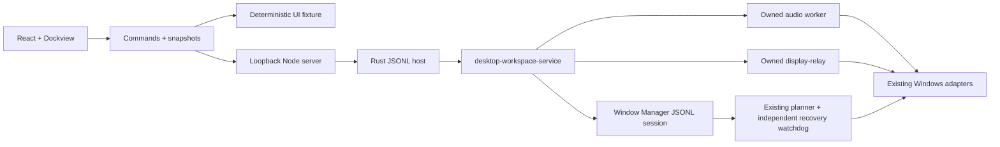

# Integrated Desktop Workspace

Audio Repeater, Display Relay, Audio Cable and Window Manager have separate
service-backed control panes. Each dockable tab contains configurable component cards with either full settings
or only preset/start controls. No second tab level is created. Tabs
can detach into native windows, and panes retain their own editor selections. Mirroring
video stays in native display-relay windows. See [setup and available controls](../apps/desktop-workspace/README.md).

The installed default is a dedicated Electron EXE with normal Windows decorations
and compact control content. Its detached daemon owns the Rust host independently
of UI windows. Native tab drag-end outside the application's content rectangles
creates a popout through the same Dockview portal, preserving controller/editor
state. Navigation and popouts are restricted to the local service origin; the
renderer has no Node integration and exposes only narrow close/drag IPC operations.

Installation separates a stable launcher, immutable hashed versions and persistent
settings. Install/update does not replace running binaries or stop ongoing jobs.
The daemon's next start uses the newly installed version; an existing daemon is
reused so jobs can survive UI updates. The daemon reads the installed UI manifest
for page requests, so reopened windows load updated controls without restarting jobs.
No global service or login startup is added.

## Architecture

Rust owns jobs/settings independently of mounted panels. The host's private
kill-on-close Job Objects cover only its audio/mirror children. Window Manager
stays outside those jobs so independent visibility recovery can finish.

The host uses a closed serde command enum over inherited JSONL pipes, without
arbitrary programs or shell commands. Window operations reuse the existing domain
protocol and planner. Revision-checked configuration edits are validated before
saving. Candidate tokens are session-local; opaque previews are consumed on apply.
Replaced previews are discarded to avoid exhausting the session preview budget.
Undo keeps current observations for authority and separate prior client-size/DPI
targets for restoration settlement.

Startup reads existing preset/cable files and queries devices. Explicit Window
Manager connection acquires the existing configuration lock. Saves check external
changes and protect malformed originals. Browser storage holds panel layout only;
complete native configuration data stay in Rust/files.

Integrated presets are stored separately in `workspace-presets.json`, under the
settings root. They capture only chosen components, without copying the Audio Cable
individual preset collection. Window entries refer to a saved view and screen region
and use the existing preview/apply authority checks; successful requests are exposed
for undo. Included routes, feedback combinations and window plans are validated before
output transitions. Unselected components stay untouched. Later runtime failures can
leave partial effects and report completed components rather than promising rollback.

HTTP binds to 127.0.0.1, validates Host/Origin and requires a per-process random
header token for commands. Requests are bounded to 1 MiB; window-session commands
retain their 64 KiB limit. Request IDs are carried into diagnostic traces.
Disconnected/incompatible services disable real controls without fixture fallback.

Popouts share the owning page's backend and editor state; reload reconnects to
jobs but resets unsaved drafts. Transfers between independently launched workspace
pages are not implemented. [Dockview popouts](https://dockview.dev/docs/core/groups/popoutGroups/)
require browser popup permission; a blocked popup leaves the panel in place.

## Coverage

Main audio, cable, mirror and manual window workflows use real services.
Group strategies/name/gap/grid columns, screen regions and per-window permissions
are editable. Unexposed authored fields are retained during saves. DPI transfer,
hide and show-state permissions default off, matching the native model.

Advanced structural group editing, collections/selectors, package import/export,
attention-provider connections and shortcut editing remain in the native GUI/CLI.
The web session does not enable shortcuts automatically and rejects provider
commands. Native applications remain available; full feature parity is not claimed.

## Validation

- Rust: startup without writes/jobs, corrupt-file protection, save conflicts,
  bounds/schema, final child logs, bounded shutdown and job containment.
- Window Manager/core: planner, authority, binding, settlement, revision, session,
  recovery and initial resize-undo regression tests.
- Node: token/origin/envelope checks prevent invalid forwarding.
- Chrome: docking/layout persistence, popouts, choices, errors, native API
  save/preview/apply sequencing and connection loss.
- Real native integration: endpoint/display inventory and isolated settings
  edits; one disposable window moved/resized/restored, including 40 replacement
  previews. User windows and audio are excluded.
- Launcher: isolated start, reuse, shutdown and copied runtime binaries.

This development workflow performs execution tests in the owned test VM, including
real mouse tear-off, daemon job survival, fractional UI persistence and signal
attenuation at 0.5%/0.05%. Host operations are limited to editing and building.
Browser fixtures and idle inventory do not certify
audible routing or hardware capture/rendering. External application compatibility
still needs per-app verification before opting into DPI transfer, hiding or show-state.

### Installed shell acceptance (2026-10-15 KST)

Verified in the owned Hyper-V `DesktopEnvironment-AudioTest`, using guest-only
settings and audio fixtures. The installed stable launcher, decimal entry/save,
update while both UI and audio images are open, updated UI delivery without daemon
restart, physical mouse tab tear-off, shared popout state, all-window close and UI
reconnect passed. Ten Node transport/fixture tests and the Rust core/service/audio
regressions passed, including preserving both STA and MTA COM initialization.

Recorded signal attenuation measured -46.020736 dB at 0.5% and -66.020088 dB at
0.05%. Mute/unmute and owned monitor shutdown passed. The continuity acceptance
also passed with measured guest CPU utilization at 100%. VM requests/results and
native-window screenshots are retained under ignored `target/vm-session/`.

The tab/pane revision additionally passed guest tests for pane lists isolated by
tab, layout restoration after reopening, preset controls above devices, separate
Audio Repeater/Display Relay preset loading, unchanged worker PID for VAC gain-only
presets, automatic restart for changed VAC routes, and keeping stopped routes
stopped. One CPU saturation run measured a 60.25 ms output gap and failed the
unchanged continuity gate; the subsequent full run passed with 0.021 ms gaps.

The card revision removes nested Dockview instances. Guest acceptance verifies one
tab level, mixed launch-only cards, audio/cable/display preset selection starting
real owned jobs, tab tear-off, and restored cards after reopening. Node's mise
runtime declaration is tracked. Existing pure load commands remain available for
editors; the UI's preset selectors use explicit load-and-run commands.

Integrated preset acceptance verifies saving all four components, selecting a preset
to apply/start them together, settings-only output shutdown, repeated application
without replacing unchanged workers, and an audio-only preset preserving cable gain
and mirror jobs. Selecting a saved preset restores its inclusion choices and window
view/region for safe overwriting. Window application exposes its request for undo.
Storage regressions cover round trips, duplicate names and external/malformed file
protection. These execution checks run in the owned VM with isolated settings and
an empty saved window layout; they do not move user windows.
The final suite passed with 100% measured guest CPU and 0.021 ms input/output gaps.
An earlier run of the unchanged CPU continuity gate failed with a 70.271 ms output
gap; the full rerun passed. This intermittent VM result is retained in the logs.
