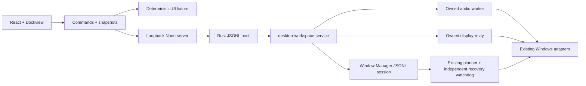

# Integrated Desktop Workspace

Desktop Control, Audio Cable and Window Manager now have native service-backed
web control panels. Tabs split, resize and detach into browser windows. Mirroring
video stays in native display-relay windows. See [setup and available controls](../apps/desktop-workspace/README.md).

The installed default is a dedicated Electron EXE with normal Windows decorations
and compact control content. Its detached daemon owns the Rust host independently
of UI windows. Native tab drag-end outside the application's content rectangles
creates a popout through the same Dockview portal, preserving controller/editor
state. Navigation and popouts are restricted to the local service origin; the
renderer has no Node integration and exposes only narrow close/drag IPC operations.

Installation separates a stable launcher, immutable hashed versions and persistent
settings. Install/update does not replace running binaries or stop ongoing jobs.
The daemon's next start uses the newly installed version; an existing daemon is
reused so jobs can survive UI updates. The daemon reads the installed UI manifest
for page requests, so reopened windows load updated controls without restarting jobs.
No global service or login startup is added.

## Architecture

Rust owns jobs/settings independently of mounted panels. The host's private
kill-on-close Job Objects cover only its audio/mirror children. Window Manager
stays outside those jobs so independent visibility recovery can finish.

The host uses a closed serde command enum over inherited JSONL pipes, without
arbitrary programs or shell commands. Window operations reuse the existing domain
protocol and planner. Revision-checked configuration edits are validated before
saving. Candidate tokens are session-local; opaque previews are consumed on apply.
Replaced previews are discarded to avoid exhausting the session preview budget.
Undo keeps current observations for authority and separate prior client-size/DPI
targets for restoration settlement.

Startup reads existing preset/cable files and queries devices. Explicit Window
Manager connection acquires the existing configuration lock. Saves check external
changes and protect malformed originals. Browser storage holds panel layout only;
complete native configuration data stay in Rust/files.

HTTP binds to 127.0.0.1, validates Host/Origin and requires a per-process random
header token for commands. Requests are bounded to 1 MiB; window-session commands
retain their 64 KiB limit. Request IDs are carried into diagnostic traces.
Disconnected/incompatible services disable real controls without fixture fallback.

Popouts share the owning page's backend and editor state; reload reconnects to
jobs but resets unsaved drafts. Transfers between independently launched workspace
pages are not implemented. [Dockview popouts](https://dockview.dev/docs/core/groups/popoutGroups/)
require browser popup permission; a blocked popup leaves the panel in place.

## Coverage

Main audio, cable, mirror and manual window workflows use real services.
Group strategies/name/gap/grid columns, screen regions and per-window permissions
are editable. Unexposed authored fields are retained during saves. DPI transfer,
hide and show-state permissions default off, matching the native model.

Advanced structural group editing, collections/selectors, package import/export,
attention-provider connections and shortcut editing remain in the native GUI/CLI.
The web session does not enable shortcuts automatically and rejects provider
commands. Native applications remain available; full feature parity is not claimed.

## Validation

- Rust: startup without writes/jobs, corrupt-file protection, save conflicts,
  bounds/schema, final child logs, bounded shutdown and job containment.
- Window Manager/core: planner, authority, binding, settlement, revision, session,
  recovery and initial resize-undo regression tests.
- Node: token/origin/envelope checks prevent invalid forwarding.
- Chrome: docking/layout persistence, popouts, choices, errors, native API
  save/preview/apply sequencing and connection loss.
- Real native integration: endpoint/display inventory and isolated settings
  edits; one disposable window moved/resized/restored, including 40 replacement
  previews. User windows and audio are excluded.
- Launcher: isolated start, reuse, shutdown and copied runtime binaries.

This development workflow performs execution tests in the owned test VM, including
real mouse tear-off, daemon job survival, fractional UI persistence and signal
attenuation at 0.5%/0.05%. Host operations are limited to editing and building.
Browser fixtures and idle inventory do not certify
audible routing or hardware capture/rendering. External application compatibility
still needs per-app verification before opting into DPI transfer, hiding or show-state.
