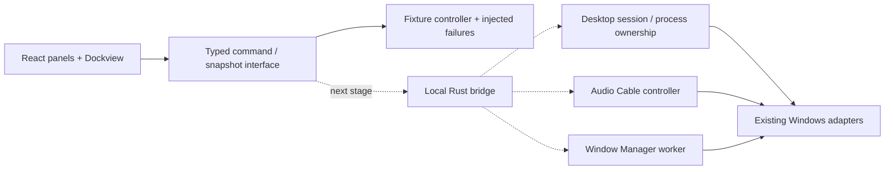

# Integrated Desktop Workspace

## Scope and present status

The target is one workspace containing the **control panels** of Desktop Control,
Audio Cable, and Window Manager. Native display-relay windows continue to render
mirroring video outside the web workspace. Embedding that video is a separate
feature, not a prerequisite for testing the control UI.

`apps/desktop-workspace` implements the initial browser-testable fixture prototype:

- tabs move between groups, split at edges, and resize;
- a panel can detach into a browser window and return to the main workspace;
- detached content shares the same controller snapshot and pending jobs;
- single choices use native radio inputs with a visible **선택됨** badge;
- multi-selection uses checkboxes and a selection count;
- window edits invalidate the previous preview; apply requires a current preview;
- diagnostics expose a request ID, operation, outcome, error code, and remedy;
- audio failures can be reproduced without physical audio or Windows window APIs.

The real backend is **not connected**. The prototype does not launch the existing
native GUI apps or claim to support their full feature sets. Native routing,
presets, monitor discovery, window binding, recovery, groups, and arrangement
editing still belong to the existing Rust implementation. No production settings
are migrated by this prototype.

## Architecture

The layout shell owns presentation only. Controller state and jobs must survive
panel unmounting, docking, and opening another window. Closing a tab must not
silently stop audio or change the current Windows arrangement. Process/session
ownership remains in Rust, with a separate explicit Stop/Shutdown action.

The current popouts are managed by the main workspace. They share the same React
backend instance; this is not an implementation of arbitrary tab transfers between
independently launched application instances. Dockview supplies the docking and
[popout lifecycle](https://dockview.dev/docs/core/groups/popoutGroups/). Browser
popups require permission; a blocked popout leaves the panel in place and shows a
message.

## Connect the existing Rust services

| Area | Existing implementation | Required extraction / integration |
| --- | --- | --- |
| Desktop Control | `apps/desktop-control/src/process.rs`, `libs/desktop-presets` | Extract session/process ownership from the egui panel into a controller. Expose snapshot, start/stop, preset CRUD, and final child logs. Keep Windows placement and mirroring native. |
| Audio Cable | `apps/audio-cable/src/panel.rs`, `libs/audio-cable-core`, `platforms/windows-audio-router` | Move worker lifetime and refresh orchestration out of the UI. Reuse the existing backend trait, gain controls, cable identities, and saved settings. |
| Window Manager | `apps/window-manager/src/service.rs`, `libs/window-manager-core` | Extract the worker into a reusable service crate. Adapt its existing Command/Event channel and domain protocol; preserve configuration revision, binding, preview/apply, monitor confirmation, journaling, and recovery. |

Do not import one app crate from another. Follow the workspace's existing
`apps` / `libs` / `platforms` boundaries. The native services remain the source of
truth; web panels consume snapshots rather than separately modifying preset files.

`WorkspaceBackend` currently exposes `getSnapshot`, `subscribe`, and `dispatch`.
Real integration should preserve the same lifecycle while replacing fixture-only
IDs and data with native DTOs. Windows domain requests should retain the existing
`window-manager-core` protocol's revision and event-cursor semantics rather than
inventing a second arrangement engine in JavaScript.

A backend failure must carry a stable code, request ID, operation, human-readable
message, and suggested correction. For example, `AUDCLNT_E_DEVICE_IN_USE` is
reported in the audio panel and diagnostics, with an explanation of the exclusive
device conflict. Console text alone is not the user-facing error contract.

The local browser build is the test target regardless of the eventual desktop
webview host. Choosing and packaging the desktop host comes after the controller
bridge, including verification of native window creation and shutdown behavior.

## Acceptance before replacing any native GUI

1. Inventory the current app's features and map each command to a real service.
   Keep unimplemented features explicitly unavailable.
2. Replay the same command sequences against fixtures and the real controller;
   assert returned state and errors, including cancellation and stale previews.
3. Run browser tests for docking, keyboard selection, reopen, separate-window
   synchronization, and error presentation without native hardware.
4. Validate native effects separately: audible routing, device changes, real
   window placement, hotkeys, process ownership, crash recovery, and shutdown.
5. Preserve existing settings without conversion until schema compatibility and
   migration have been tested. Starting the workspace must not auto-apply layouts
   or start audio.

Passing fixture/browser tests confirms presentation and orchestration behavior.
It does not certify WASAPI drivers, capture rendering, or Windows placement.
